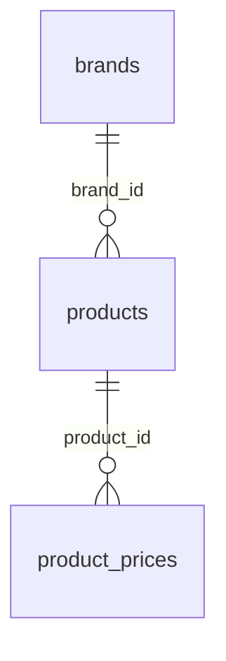

# Анализ предоставленного бэкапа

Бэкап от 01.11.2026: gzip, около 1,49 МБ; распакованный SQL — около 14,29 МБ.
Заголовок указывает MariaDB 11.8.9, кодировку utf8mb4. Для локальной проверки
используется MariaDB 11.8.6 и PHP 8.4.27 (приложение рассчитано на PHP 8.2+;
отдельный прогон на 8.2 ещё не выполнен).

SQL содержит DROP TABLE, CREATE TABLE, INSERT, LOCK/UNLOCK и настройки сессии.
Полный дамп не исполнялся. Утилита `tools/extract_catalog.py` читает только
литеральные данные трёх разрешённых таблиц и проверяет порядок их столбцов.
Выражения и вызовы функций в выбранных INSERT отвергаются. В SQL локального
импорта передаются только параметризованные значения из извлечённого JSON.

## Состав

Найдено 14 таблиц:

| Таблица | Назначение и использование |
| --- | --- |
| `brands` | Бренды; импортировано 9 записей |
| `products` | Ароматы; импортировано 63 записи |
| `product_prices` | Объёмы, цены, акции, остатки; импортировано 189 записей |
| `competitor_prices` | Конкурентные цены; не импортирована |
| `orders` | Заказы, контактные данные; не импортирована |
| `orders_backup_1131_2026_10_16` | Резервная таблица заказов; не импортирована |
| `orders_backup_2026_10_18` | Резервная таблица заказов; не импортирована |
| `pages` | Контент страниц, в том числе HTML; не импортирована |
| `pages_backup_2026_10_22` | Резервная таблица контента; не импортирована |
| `price_changes` | История цен, в том числе IP; не импортирована |
| `reviews` | Отзывы и данные авторов; не импортирована |
| `settings` | Настройки прежнего сайта; не импортирована, значения не переносились |
| `visits` | Статистика и IP посетителей; не импортирована |
| `visits_bak_lpstat` | Резервная статистика; не импортирована |

Исходный файл содержит чувствительные данные. Он хранится вне репозитория;
его данные не включены в исходники, тестовые фикстуры или эту документацию.
В каталог перенесены только товарные данные; JSON и БД исключены из Git.

## Фактические связи каталога

- `brands`: PK `id`, уникальный `slug`, название, подпись, описание, SEO-поля,
  порядок сортировки.
- `products`: PK `id`, уникальный `sku`, FK `brand_id`, название, пол,
  группа ароматов, верхние/сердечные/базовые ноты, год выпуска как текст,
  описание, SEO-поля, сортировка, флаги `in_stock_msk` и `in_stock_spb`.
- `product_prices`: PK `id`, FK `product_id` с ON DELETE CASCADE,
  уникальная пара (`product_id`, `volume_ml`), `price` и `promo_price`
  типа DECIMAL(10,2), `promo_until` DATETIME, `stock` INT.

На импортированной копии нет товаров без существующего бренда и цен без
существующего товара. В исходных данных на каждый аромат приходится три ценовых варианта.
По правилу магазина 5 и 10 мл исключены из витрины; остаются 63 варианта
больших флаконов — 70, 75, 90, 100 мл. Разрешённые объёмы перечислены
в `config/catalog.php`. Признака заводской упаковки в схеме нет: объём
не доказывает тип упаковки, поэтому требуется проверка поставщика.
Объёмы: 5, 10, 70, 75, 90, 100 мл; нельзя ограничивать их списком из комментария
столбца («100, 50 или 5») — он не соответствует фактическим данным.
Изображений и путей к ним в этих таблицах нет.

## Правила первой витрины

Цены интерпретируются как рубли для магазина в России. Они обрабатываются как
DECIMAL/строки без float. Положительная акционная цена ниже основной применяется,
если срок не истёк; NULL в сроке трактуется как бессрочная акция. Это выбранные
правила витрины, а не подтверждённые правила старого сайта. Часовой пояс PHP —
Europe/Moscow, сессии БД — +03:00. Перед реальной продажей следует подтвердить
валюту, трактовку NULL и часовой пояс старых значений DATETIME.

`stock > 0` обнаружен у 104 вариантов; городские флаги установлены у 63 ароматов
для Москвы и 47 для Санкт-Петербурга. Эти показатели описывают разные уровни
данных. Их приоритет не установлен, поэтому витрина не обещает наличие и не
принимает заказы. Минимальная цена карточки вычисляется только среди положительных цен
разрешённых больших объёмов, независимо от остатка. Пробники и отливанты
не входят в ассортимент и не участвуют в расчёте цены.

`products.sku` используется для URL карточки; все текущие значения совместимы
с выбранным форматом URL. Фильтр бренда использует `brands.slug`. Поиск работает
по названиям аромата и бренда, спецсимволы LIKE интерпретируются буквально.
Описание выводится как экранированный текст, без исполнения HTML.

## Следующая реализация

Таблица `orders` уже существует: в ней предусмотрены SKU, имя аромата и бренда,
объём, цена, контактные данные, город, способ связи, комментарий, промокод,
статус и время создания. До реализации корзины необходимо проверить правила
заказа нескольких позиций, варианты доставки, статусы, учёт остатков и
идемпотентность. Новую схему заказов заранее не создаём.

Боевая база и сервер не использовались и не изменялись. Подключение витрины
выполняется через локальный Unix-сокет к отдельной базе `parfum_place_dev`;
TCP у локального сервера отключён. Пользователь витрины имеет SELECT только
на три таблицы каталога. Импортёр предназначен только для отдельного dev-сервера
и отказывается перезаписывать существующую базу.
